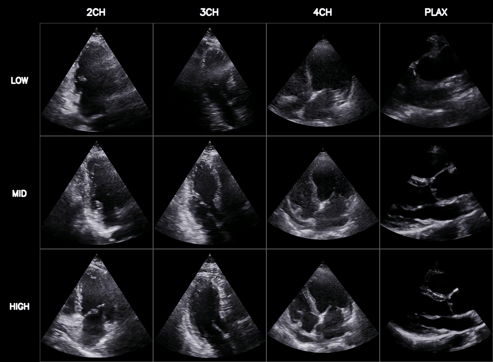

# EchoQuality


## About

EchoQuality is a deep-learning model for automated and reproducible assessment of echocardiographic image quality. Developed from 7,475 expert-annotated videos, it was evaluated across five international cohorts comprising 762,588 videos from 25,205 studies.

Image quality was a major determinant of AI performance across echocardiographic measurements, dysfunction and disease detection, view identification, and left-ventricular segmentation. High-quality studies achieved the best performance in 73% of evaluations, while a quality-aware aggregation strategy improved performance in 84% of evaluations. These findings show that incorporating image-quality awareness can improve the robustness and clinical reliability of echocardiographic AI systems.

---

> **Pretrained weights**: Available at 🤗 https://huggingface.co/CardiovascularImagingVHIR/EchoQuality

## Examples



## How to use

1. Download the file `echoqual.pt` from the HuggingFace link above.
2. Place it in: `results/echoQual_inference/`.
3. In `inference_echoqual.py`, update **line 192**:
   - Set `root_path` to the directory containing your input videos.
   - **IMPORTANT**: Input videos should have **256×256 pixel resolution** and **original frame length**, preferably in **MP4 or AVI format**.
4. Create and activate the environment using the provided `content/torchone.yml` file.
5. Run:
   ```bash
   python inference_echoqual.py
   ```
6. The script generates two output files in `results/echoQual_inference/`:
   - `inference_sample_predictions_*.csv`: predictions at sample level.
   - `inference_predictions_*.csv`: aggregated predictions at video level.

7. In case of error while loading the backbone, download the file `backbone_structure.pt` from the HuggingFace and place it in: `results/echoQual_inference/`.

## Citation

If you use this work, please cite ... (not yet)
