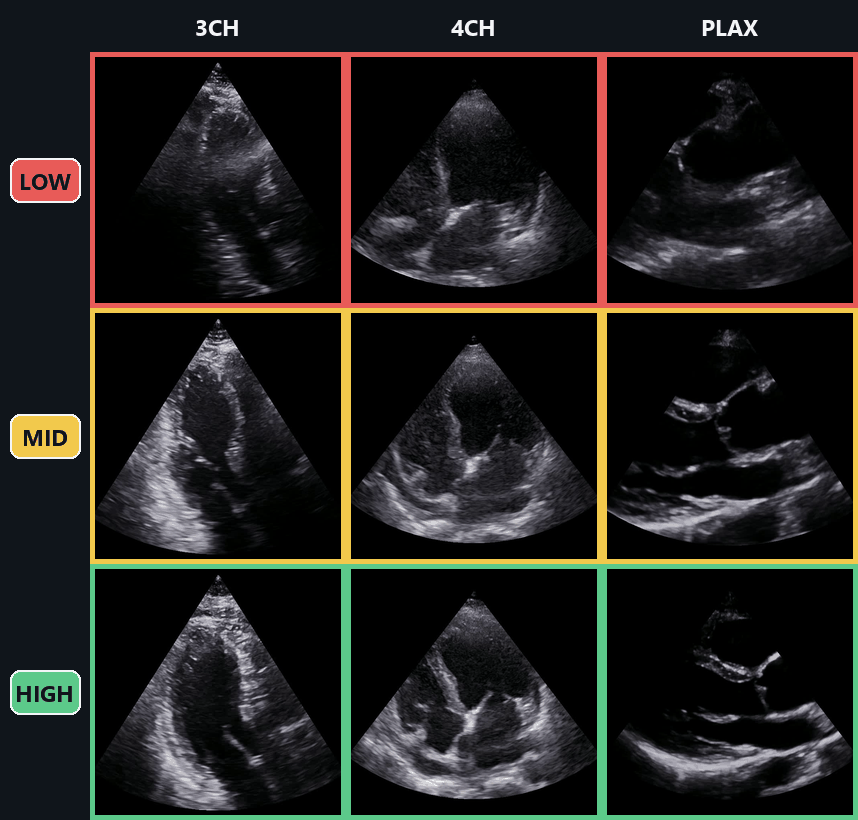

# EchoQuality: Automated echocardiography image quality assessment and its association with AI performance

<p align="center">
  
  <a href="https://github.com/CardiovascularImagingVallHebron/EchoQuality"></a>
  <a href="https://huggingface.co/CardiovascularImagingVHIR/EchoQuality"></a>
</p>

EchoQuality is a deep-learning model for automated and reproducible assessment of echocardiographic image quality.

---


## About

Trained with 6,037 expert-annotated videos, EchoQuality was tested in 1,903 internal and 1,000 external videos.

The impact of image quality as predicted by EchoQuality on the accuracy of several state-of-the-art AI models for echocardiography evaluation was analysed across five international cohorts comprising 762,588 videos from 25,205 studies.

---

> **Pretrained weights**: Available at 🤗 https://huggingface.co/CardiovascularImagingVHIR/EchoQuality

## Examples

Same patient, same study, same view, shown at three different quality levels.



## How to use

1. Download the file `echoqual.pt` from the HuggingFace link above.
2. Place it in: `results/echoQual_inference/`.
3. Create and activate the environment using the provided `content/torchone.yml` file.
4. Run the script with the directory containing your input videos as the `root_path` argument:
   ```bash
   python inference_echoqual.py /path/to/videos
   ```
   Input videos should have **256×256 pixel resolution** and **original frame length**, preferably in **MP4 or AVI format**.
5. The script generates two output files in `results/echoQual_inference/`:
   - `inference_sample_predictions_*.csv`: predictions at sample level.
   - `inference_predictions_*.csv`: aggregated predictions at video level.

6. In case of error while loading the backbone, download the file `backbone_structure.pt` from the HuggingFace and place it in: `results/echoQual_inference/`.

## Citation

If you use this work, please cite ... (not yet)
