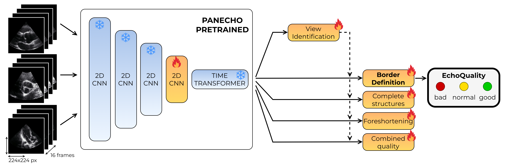

# EchoQuality

## Overview
EchoQuality is a deep learning model for assessing echocardiographic image quality. It provides a consistent and objective evaluation of image quality, addressing the variability and subjectivity of human grading.

## Model Architecture

EchoQuality is built by fine-tuning the PanEcho model for image quality assessment and adding specific quality tasks.

## Scientific Background
Initial analysis results were presented at [**EuroEcho 2024**](https://academic.oup.com/ehjcimaging/article/26/Supplement_1/jeae333.030/7986421?login=true)

## Introduction
Echocardiography image quality is highly variable and human grading is subjective. As AI adoption grows, understanding the impact of image quality becomes essential.

## Methods
EchoQuality was developed by fine-tuning [PanEcho](https://github.com/CarDS-Yale/PanEcho) using **6,475 videos** annotated by three cardiologists:

- **5,057 videos** for development  
- **1,418 videos** for testing  

Quality was defined by the clarity of the delineation between the blood pool and cardiovascular structures (border definition).

## Purpose
- Provide a reproducible framework for echocardiographic quality assessment  
- Evaluate the impact of image quality on downstream AI models  
- Support research in cardiac imaging analysis  

## Citation
If you use this work, please cite ... (not yet)
