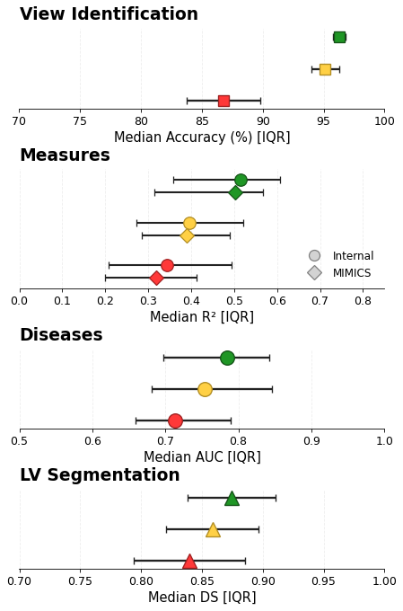

# EchoQuality

> **Pretrained weights**: Available at 🤗 https://huggingface.co/CardiovascularImagingVHIR/EchoQuality

## Manual Usage

1. Download the file `echoqual.pt` from the HuggingFace link above.
2. Place it in: `results/echoQual_inference/`.
3. In `inference_echoqual.py`, update **line 192**:
   - Set `root_path` to the directory containing your input videos.
   - **IMPORTANT**: Input videos should have **256×256 pixel resolution** and **original frame length**, preferably in **MP4 or AVI format**.
4. Create and activate the environment using the provided `content/torchone.yml` file.
5. Run:
   ```bash
   python inference_echoqual.py
   ```
6. The script generates two output files in `results/echoQual_inference/`:
   - `inference_sample_predictions_*.csv`: predictions at sample level.
   - `inference_predictions_*.csv`: aggregated predictions at video level.

7. In case of error while loading the backbone, download the file `backbone_structure.pt` from the HuggingFace and place it in: `results/echoQual_inference/`.

## Citation

If you use this work, please cite ... (not yet)

---

## Overview

EchoQuality is a deep learning model for assessing echocardiographic image quality.

## Purpose

- Provide a reproducible framework for echocardiographic quality assessment.
- Evaluate the impact of image quality on downstream AI models.
- Support research in cardiac imaging analysis.

## Model Architecture


EchoQuality is built by fine-tuning the PanEcho model for image quality assessment, adding specific quality tasks.

## Scientific Background

Initial analysis results were presented at [**EuroEcho 2024**](https://academic.oup.com/ehjcimaging/article/26/Supplement_1/jeae333.030/7986421?login=true) [1]

## Development

EchoQuality was developed by fine-tuning [PanEcho](https://github.com/CarDS-Yale/PanEcho) (PAN) [2] using **6,475 videos** annotated by three cardiologists:

- **5,057 videos** for development
- **1,418 videos** for testing

Quality was defined by the clarity of the delineation between the blood pool and cardiovascular structures (border definition).

### Downstream Evaluation Overview

(i) Disease classification using PAN and EchoPrime (EP) [3] on **287,044 videos from 14,301 studies**, and up to 16 measurements on **469,591 videos from 21,465 studies** (in-house + MIMICS [4]).

(ii) View identification using Zhang (ZH) [5] and EP on **6,697 videos from 464 studies**.

(iii) Left ventricular (LV) segmentation using two models [6] (trained on CAMUS [7] and EchoNet-Dynamic [8]) on **1,969 frames from 100 CAMUS videos** (Dice score).

(iv) Human reproducibility in AHA-region-level LV strain (RS) and global longitudinal strain (GLS) in **587 videos from 100 studies**.

## Results

In 3-class quality classification, the inter-observer agreement was **56%**, and EchoQuality achieved **58% test accuracy**.

Across downstream tasks (disease classification, view identification, LV segmentation, and strain analysis), good-quality studies consistently outperformed bad-quality ones, improving accuracy, AUC, R², Dice score, and reducing variability in clinical measurements.



---

## References

1. Lopez-Gutierrez P, Morales A, Dux-Santoy L, et al. Echocardiography image quality assessment: human subjectivity and artificial intelligence prediction in multi-centre data. European Heart Journal - Cardiovascular Imaging. 2025;26(suppl 1):jeae333.030.
2. Holste G, Oikonomou EK, Tokodi M, Kovács A, Wang Z, Khera R. Complete AI-enabled echocardiography interpretation with multitask deep learning. JAMA. 2025;334(4):306-318.
3. Vukadinovic M, Chiu IM, Tang X, et al. Comprehensive echocardiogram evaluation with view-primed vision-language AI. Nature. 2025.
4. Johnson A, Bulgarelli L, Pollard T, Horng S, Celi LA, Mark R. MIMIC-IV, version 2.2. PhysioNet. 2023. RRID:SCR_007345.
5. Zhang J, Gajjala S, Agrawal P, et al. Fully automated echocardiogram interpretation in clinical practice: feasibility and diagnostic accuracy. Circulation. 2018;138(16):1623-1635.
6. Van De Vyver G, Lenz AT, Smistad E, et al. Generative augmentations for improved cardiac ultrasound segmentation using diffusion models. Sci Rep. 2025;15:38013.
7. Leclerc S, Smistad E, Pedrosa J, et al. Deep learning for segmentation using an open large-scale dataset in 2D echocardiography. IEEE Trans Med Imaging. 2019;38(9):2198-2210.
8. Ouyang D, He B, Ghorbani A, et al. Video-based AI for beat-to-beat assessment of cardiac function. Nature. 2020;580:252-256.
