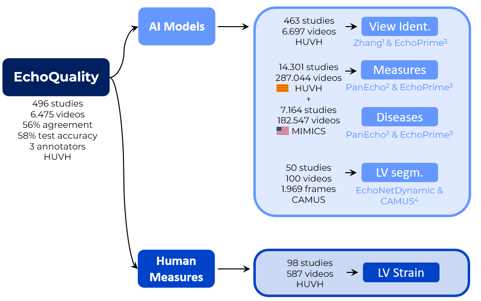
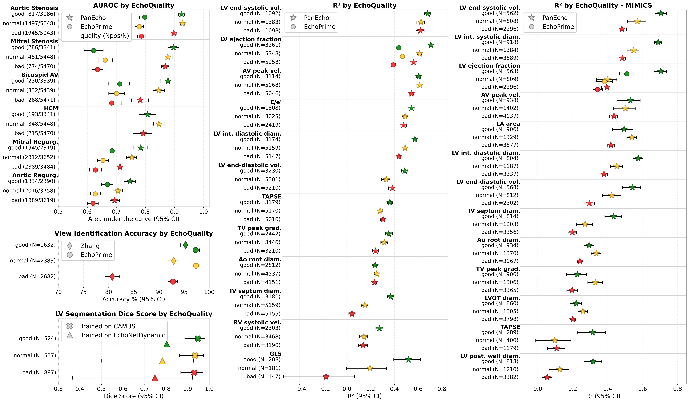
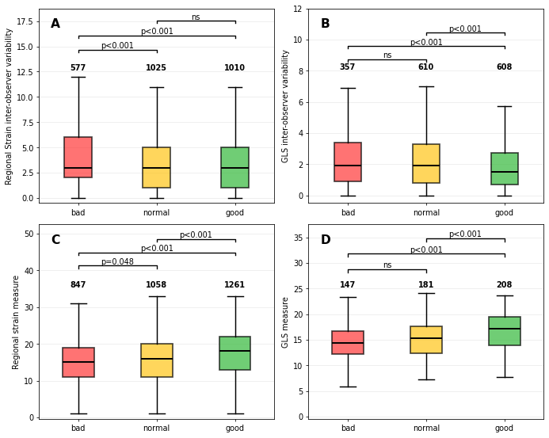

# EchoQuality

## Overview
EchoQuality is a deep learning model for assessing echocardiographic image quality. It provides a consistent and objective evaluation of image quality, addressing the variability and subjectivity of human grading.

## Model Architecture

EchoQuality is built by fine-tuning the PanEcho model for image quality assessment and adding specific quality tasks.

## Scientific Background
Initial analysis results were presented at [**EuroEcho 2024**](https://academic.oup.com/ehjcimaging/article/26/Supplement_1/jeae333.030/7986421?login=true)

## Introduction
Echocardiography image quality is highly variable and human grading is subjective. As AI adoption grows, understanding the impact of image quality becomes essential.

## Purpose
- Provide a reproducible framework for echocardiographic quality assessment  
- Evaluate the impact of image quality on downstream AI models  
- Support research in cardiac imaging analysis
  
## Methods
EchoQuality was developed by fine-tuning [PanEcho](https://github.com/CarDS-Yale/PanEcho) using **6,475 videos** annotated by three cardiologists:

- **5,057 videos** for development  
- **1,418 videos** for testing  

Quality was defined by the clarity of the delineation between the blood pool and cardiovascular structures (border definition).

### Downstream Evaluation Overview

(i) Disease classification using PAN and EchoPrime (EP) [3] on **287,044 videos from 14,301 studies**, and up to 16 measurements on **469,591 videos from 21,465 studies** (in-house + MIMICS [4]).

(ii) View identification using Zhang (ZH) [5] and EP on **6,697 videos from 464 studies**.

(iii) Left ventricular (LV) segmentation using two models [6] (trained on CAMUS [7] and EchoNet-Dynamic [8]) on **1,969 frames from 100 CAMUS videos** (Dice score).

(iv) Human reproducibility in AHA-region-level LV strain (RS) and global longitudinal strain (GLS) in **587 videos from 100 studies**.

## Results
In 3-class quality classification, the inter-observer agreement was **56%**, and EchoQuality achieved **58% test accuracy**.

Across downstream tasks (disease classification, view identification, LV segmentation, and strain analysis), good-quality studies consistently outperformed bad-quality ones, improving accuracy, AUC, R², Dice score, and reducing variability in clinical measurements.

### AI models results:

### Strain results:

## Citation
If you use this work, please cite ... (not yet)
